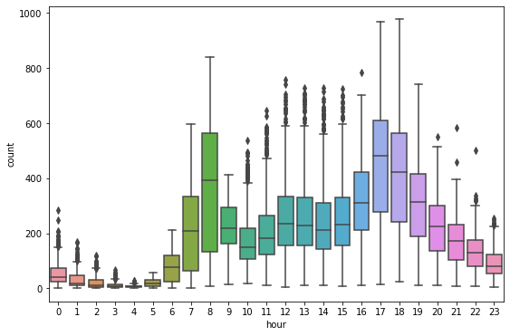

# Bike demand: EDA and two OLS specifications

[← Portfolio](../../../README.md) · [Open notebook](../../../python_machine_learning/Mini_project_Kaggle_Bike_Sharing_Demand_Modeling.ipynb)

> Source repaired in 2026. Earlier outputs remain historical; focused checks are recorded separately.

## Question

Explore rental counts and compare an additive linear model with an interaction model.

## Data and access

External Bike_Sharing_Demand.csv from the raw URL in cell 5; saved metadata describe 10,886 rows and 12 original columns. Datetime is expanded to year/month/day/hour; casual and registered are used for early EDA.

## Method and pipeline

After EDA, cell 48 removes casual/registered and selected fields. A random 70%/30% split feeds statsmodels formula OLS: an additive seven-predictor model and a second model with holiday×workingday and temp×humidity×windspeed interactions. RMSE is sqrt(mean_squared_error(test count,prediction)).

## Read the source

| Cell | Opening statement |
|---|---|
| 3 | `import warnings` |
| 5 | `import pandas as pd` |
| 6 | `DF.head()` |
| 9 | `DF['datetime'] = DF.datetime.apply(pd.to_datetime)` |
| 10 | `DF.head(24)` |
| 12 | `drop_columns = ['datetime'] #'casual', 'registered']` |
| 13 | `DF.info()` |
| 14 | `DF['year'].value_counts()` |
| 15 | `DF.head()` |
| 18 | `import numpy as np` |
| 19 | `plt.figure(figsize = (15, 10))` |
| 20 | `DF['season'].value_counts()` |
| 22 | `plt.figure(figsize = (8, 4))` |
| 24 | `DF['workingday'].value_counts()` |
| 25 | `DF['holiday'].value_counts()` |
| 27 | `plt.figure(figsize = (9, 6))` |
| 28 | `plt.figure(figsize = (8, 4))` |
| 30 | `plt.figure(figsize = (8, 4))` |
| 31 | `plt.figure(figsize = (9, 6))` |
| 33 | `plt.figure(figsize = (8, 4))` |
| 34 | `plt.figure(figsize = (9, 6))` |
| 36 | `plt.figure(figsize = (8, 4))` |
| 37 | `plt.figure(figsize = (9, 6))` |
| 39 | `plt.figure(figsize = (9, 6))` |
| 42 | `plt.figure(figsize = (9, 6))` |
| 43 | `plt.figure(figsize = (9, 6))` |
| 44 | `plt.figure(figsize = (9, 6))` |
| 45 | `plt.figure(figsize = (9, 6))` |
| 46 | `plt.figure(figsize = (9, 6))` |
| 47 | `sns.pairplot(DF)` |
| 48 | `drop_columns = ['casual','registered','year','day','season','atemp','weather'] # 서로 겹치거나 필요없는` |
| 49 | `DF.info()` |
| 51 | `train_set, test_set = train_test_split(DF, test_size = 0.3, random_state = 2045)` |
| 52 | `train_set.info()` |
| 53 | `Model_1 = smf.ols(formula = 'count ~ holiday + workingday + temp + humidity + windspeed + month + hour', data ` |
| 54 | `y_hat_1 = Model_1.predict(test_set[['holiday', 'workingday', 'temp',  'humidity',  'windspeed', 'month' , 'hou` |
| 55 | `mse1 = mean_squared_error(test_set['count'], y_hat_1)` |
| 56 | `test_set.info()` |
| 57 | `Model_2 = smf.ols(formula = 'count ~ holiday*workingday + temp*humidity*windspeed + month + hour', data = trai` |
| 58 | `y_hat_2 = Model_2.predict(test_set[['holiday', 'workingday', 'temp',  'humidity',  'windspeed', 'month' , 'hou` |
| 59 | `mse2 = mean_squared_error(test_set['count'], y_hat_2)` |
| 60 | `(empty)` |

Read preprocessing before fitting, then compare the evaluation target and predictions. Later cells may reuse the same model/data objects. Restart the kernel before a clean full run.

## Results and evidence

Historical cells 55 and 59 contain TypeError from passing a method as the target. Both actual OLS formulas and corrected metric cells pass a fresh synthetic-data integration check. No fresh Kaggle RMSE or ranking is claimed.

*Original saved output, cell 44. It predates the source repairs and is not a newly generated result.*

## Limitations

count is a column name that collides with DataFrame.count; bracket indexing is required. Count components are excluded before modeling. The random split and numerical month/hour treatment do not represent a chronological competition forecast. OLS may predict negative counts.

## Execution and dependencies

**Imports observed:** `matplotlib.pyplot`, `numpy`, `pandas`, `seaborn`, `sklearn.metrics`, `sklearn.model_selection`, `statsmodels.formula.api`, `warnings`.

Read the [reproduction guide](../../REPRODUCIBILITY.md) before execution. Inspect network, Colab mount and unzip cells. External-data versions and the original environment are not locked.

## Attribution

The original notebook header credits the MultiCampus Data Science lectures. Exact original dates and individual/team contribution remain unverified.
