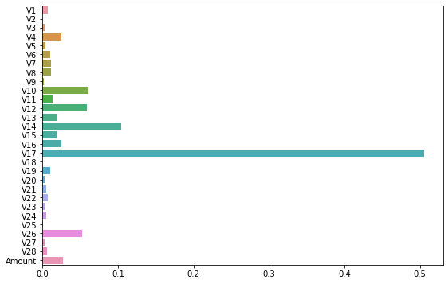

# Rare-event detection with full and shallow trees

[← Portfolio](../../../README.md) · [Open notebook](../../../python_machine_learning/Mini_project_Kaggle_Fraud_Detection_Modeling.ipynb)

> Source repaired in 2026. Earlier outputs remain historical; focused checks are recorded separately.

## Question

Compare fraud-class precision and recall for an unconstrained tree and a depth-limited tree.

## Data and access

External Kaggle creditcard.csv, supplied via a Drive ZIP; saved metadata show 284,807 rows and 31 columns. Time is removed, leaving 29 predictors and Class. The data are not bundled.

## Method and pipeline

Show unstratified and then stratified 70%/30% splits. Fit an unrestricted DecisionTreeClassifier and a separate max_depth=5 estimator. Inspect confusion matrices, per-class metrics, importance plots and tree diagrams.

## Read the source

| Cell | Opening statement |
|---|---|
| 3 | `import warnings` |
| 5 | `from google.colab import drive` |
| 7 | `!ls -l '/content/drive/My Drive/Colab Notebooks/datasets/creditCardFraud.zip'` |
| 10 | `!unzip /content/drive/My\ Drive/Colab\ Notebooks/datasets/creditCardFraud.zip` |
| 12 | `!ls -l` |
| 14 | `%%time` |
| 15 | `DF.head()` |
| 17 | `DF.Class.value_counts()` |
| 19 | `(DF.Class.value_counts() / DF.shape[0]) * 100` |
| 21 | `DF.drop('Time', axis = 1, inplace = True)` |
| 23 | `X = DF.iloc[:,:-1]` |
| 25 | `from sklearn.model_selection import train_test_split` |
| 27 | `print('Train_Data :','\n', (y_train.value_counts() / y_train.shape[0]) * 100)` |
| 29 | `from sklearn.model_selection import train_test_split` |
| 31 | `print('Train_Data :','\n', (y_train.value_counts() / y_train.shape[0]) * 100)` |
| 34 | `from sklearn.tree import DecisionTreeClassifier` |
| 35 | `Model_dt = DecisionTreeClassifier(random_state = 2045)` |
| 36 | `from sklearn.tree import plot_tree` |
| 37 | `# Limit the displayed depth for readability; use the estimator's actual class order.` |
| 39 | `y_hat = Model_dt.predict(X_test)` |
| 40 | `from sklearn.metrics import confusion_matrix` |
| 41 | `from sklearn.metrics import accuracy_score, precision_score, recall_score` |
| 43 | `Model_dt.feature_importances_` |
| 44 | `plt.figure(figsize=(9, 6))` |
| 46 | `from sklearn.tree import DecisionTreeClassifier` |
| 47 | `# Limit the displayed depth for readability; use the estimator's actual class order.` |
| 48 | `y_hat_P5 = Model_pr.predict(X_test)` |
| 49 | `print(confusion_matrix(y_test, y_hat_P5))` |
| 50 | `print(accuracy_score(y_test, y_hat_P5))` |
| 51 | `Model_pr.feature_importances_` |
| 52 | `plt.figure(figsize=(9, 6))` |

Read preprocessing before fitting, then compare the evaluation target and predictions. Later cells may reuse the same model/data objects. Restart the kernel before a clean full run.

## Results and evidence

Historical fraud precision/recall: full tree 0.78947/0.81081; shallow tree 0.89130/0.83108 (cells 41/50). Confusion matrices are [[85263,32],[28,120]] and [[85280,15],[25,123]], with actual class order 0/1. These are saved results, not a new full-data run.

*Original saved output, cell 44. It predates the source repairs and is not a newly generated result.*

## Limitations

The former pruning diagram drew Model_dt rather than Model_pr. plot_tree(max_depth=5) only limits a display; fitting max_depth=5 actually constrains the model. Both models are evaluated on the same watched holdout, so selecting from it needs independent validation. Accuracy alone hides rare-event errors.

## Execution and dependencies

**Imports observed:** `google.colab`, `matplotlib.pyplot`, `pandas`, `seaborn`, `sklearn.metrics`, `sklearn.model_selection`, `sklearn.tree`, `warnings`.

Read the [reproduction guide](../../REPRODUCIBILITY.md) before execution. Inspect network, Colab mount and unzip cells. External-data versions and the original environment are not locked.

## Attribution

The original notebook header credits the MultiCampus Data Science lectures. Exact original dates and individual/team contribution remain unverified.
