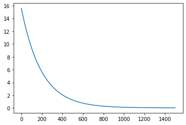

# Linear regression from explicit gradients

[← Portfolio](../../../README.md) · [Open notebook](../../../python_machine_learning/Gradient_Descent.ipynb)

> Source repaired in 2026. Earlier outputs remain historical; focused checks are recorded separately.

## Question

Understand how weight and intercept updates minimize mean squared error.

## Data and access

Embedded five-point arrays illustrate a first step; the regression section reads external testData.csv from the raw GitHub URL in cell 26 and expects inputs/outputs columns.

## Method and pipeline

Machine computes wx+b. Gradient averages −2x(y−ŷ) and −2(y−ŷ). The first loop runs 1,500 updates at step 0.05; the loss-recording section uses step 0.001 and plots the full, early and late loss histories.

## Read the source

| Cell | Opening statement |
|---|---|
| 3 | `import warnings` |
| 5 | `import numpy as np` |
| 7 | `def Machine(x, w, b):` |
| 9 | `x = np.array([1, 3, 5, 7, 9])` |
| 11 | `Machine(x, w, b)` |
| 13 | `def Gradient(x, y, w, b):` |
| 15 | `y = np.array([2, 4, 6, 8, 10])` |
| 16 | `print('dw is ', dw)` |
| 18 | `def Learning(x, y, w, b, step):` |
| 20 | `step = 0.05` |
| 21 | `print('Updated_w is ', '%.3f' % uw)` |
| 24 | `import pandas as pd` |
| 26 | `url = 'https://raw.githubusercontent.com/rusita-ai/pyData/master/testData.csv'` |
| 28 | `DATA.info()` |
| 29 | `DATA.head()` |
| 31 | `plt.scatter(DATA.inputs, DATA.outputs, s = 0.5)` |
| 33 | `w = 2` |
| 34 | `for i in range(0, 1500):` |
| 35 | `print('Learned_w is ', '%.3f' % w)` |
| 37 | `X = np.linspace(0, 1, 100)` |
| 40 | `def Gradient_with_loss(x, y, w, b):` |
| 42 | `def Learning_with_loss(x, y, w, b, step):` |
| 44 | `w = 2` |
| 45 | `for i in range(0, 1500):` |
| 47 | `Error[0:10]` |
| 48 | `plt.plot(Error)` |
| 49 | `plt.plot(Error[0:50], '.')` |
| 50 | `plt.plot(Error[1450:1500], '.')` |

Read preprocessing before fitting, then compare the evaluation target and predictions. Later cells may reuse the same model/data objects. Restart the kernel before a clean full run.

## Results and evidence

Historical fitted lines and loss curves are retained. Fresh tests verify both derivatives by central differences and convergence to a known synthetic line; no new remote-data fit is claimed.

*Original saved output, cell 48. It predates the source repairs and is not a newly generated result.*

## Limitations

Later functions are now named Gradient_with_loss and Learning_with_loss, so earlier cells retain their two-value API after the later section has run. Learning rate depends on feature scale; the five-point step is not a convergence proof.

## Execution and dependencies

**Imports observed:** `matplotlib.pyplot`, `numpy`, `pandas`, `warnings`.

Read the [reproduction guide](../../REPRODUCIBILITY.md) before execution. Inspect network, Colab mount and unzip cells. External-data versions and the original environment are not locked.

## Attribution

The original notebook header credits the MultiCampus Data Science lectures. Exact original dates and individual/team contribution remain unverified.
