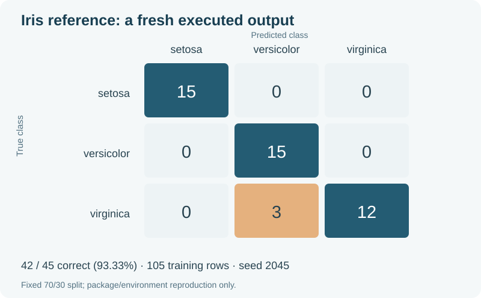

# Iris 랜덤 포리스트 — 새 환경에서 원본 노트북 재현

[전체 안내](../../../README.md) · [English](README.md) · [원본](../../../python_machine_learning/Random_Forest.ipynb)

기존 2026 참조 예제의 설치·전체 실행을 확인하는 작업입니다. 새 모델 연구·비교·튜닝이 아니며 외부 데이터 노트북 전체를 재현했다고 주장하지 않습니다. 원본 파일은 바꾸지 않고 새 Jupyter 커널에서 실행합니다.

## 실행

Python 3.11을 사용하고 저장소 루트에서 실행합니다.

```console
python tools/reproduce_random_forest.py --bootstrap --reference docs/reproduction/random-forest/2026-10-29/prediction-fingerprint.json
```

새 `.venv`에 고정 의존성(Windows 런타임 45개와 Linux 조건부 항목 2개)을 설치하고 `pip check` 후 그 환경의 Python으로 커널을 시작합니다. 패키지 설치는 공개 PyPI 인터넷 연결이 필요하지만 Iris 실행은 패키지 내장 자료를 사용합니다. 기존 `.venv`는 덮어쓰지 않으며 다른 빈 경로를 `--venv-path`로 지정할 수 있습니다. 전체 과거 저장소의 설치 환경을 변경하는 명령이 아닙니다.

새 실행 결과는 날짜를 붙인 `outputs/random-forest-reproduction/` 아래에 저장합니다. 이미 준비한 가상환경에서는 해당 환경의 Python으로 `--bootstrap` 없이 실행합니다. 소스 해시·학습/평가 분리·지정 커널·결과 일치가 확인되어야 성공 결과를 저장합니다.

## 확인한 계약

- 원본 노트북 SHA-256과 코드 셀이 실행 전후 동일합니다.
- 실제 커널이 요청한 가상환경을 사용합니다.
- 학습 105개·평가 45개이며 클래스별 학습/평가가 35/15개입니다.
- 두 집합의 인덱스 중복은 0개입니다.
- 원본 설정은 트리 200개·깊이 4·시드 2045·작업 1개입니다.
- 기존 유지보수 검사 조건인 정확도 >0.8과 중요도 합 1, 검토한 예측 배열을 확인합니다.

바이트 해시는 실제 실행본 기준입니다. Windows의 CRLF와 Linux의 LF 체크아웃을 비교할 수 있도록 LF로 정규화한 해시도 별도로 기록합니다.

## 새 실행 출력



평가 45개 중 42개가 일치하여 93.33%입니다. virginica 3개를 versicolor로 분류한 오류도 함께 남깁니다. 이 한 분할의 출력은 과거 성적·성능 향상·다른 모델 대비 우수성을 뜻하지 않습니다.

[실행한 노트북](2026-10-29/executed.ipynb) · [결과/버전](2026-10-29/result.json) · [출력](2026-10-29/stdout.txt) · [예측 확인값](2026-10-29/prediction-fingerprint.json)

## 검증 범위

Linux/Windows의 Python 3.11에서 새 환경을 만드는 [자동 검사](../../../.github/workflows/random-forest-reproduction.yml)를 함께 준비했습니다. 실제 GitHub 실행 결과와 로컬 결과는 구분해 기록합니다. 운영체제·Python 패치 버전·모든 wheel의 해시까지 고정한 것은 아닙니다.

[팩트] 2026-10-29 게시 커밋 `6b7d4aa`의 [GitHub 실행 40969888400](https://github.com/Joon-Jeremy-Chun/Machine_Learning_summary/actions/runs/40969888400)에서 Linux·Windows 두 작업이 모두 성공했습니다. 새 고정 환경 설치·`pip check`·원본 노트북 전체 실행·예측 일치를 확인했습니다. [결과 JSON](2026-10-29/hosted-ci.json)은 해당 커밋의 기록이며 후속 실행은 Actions에서 확인합니다.

이번 결과는 기존 예제 재현이라는 운영 검증이며 새 연구 가설을 판정한 것이 아닙니다. 정책에 따라 로그와 인계 기록으로 묶어 보존합니다. 외부 데이터가 필요한 회귀·사기 탐지 등 다른 노트북의 전체 실행 상태는 별도입니다.
